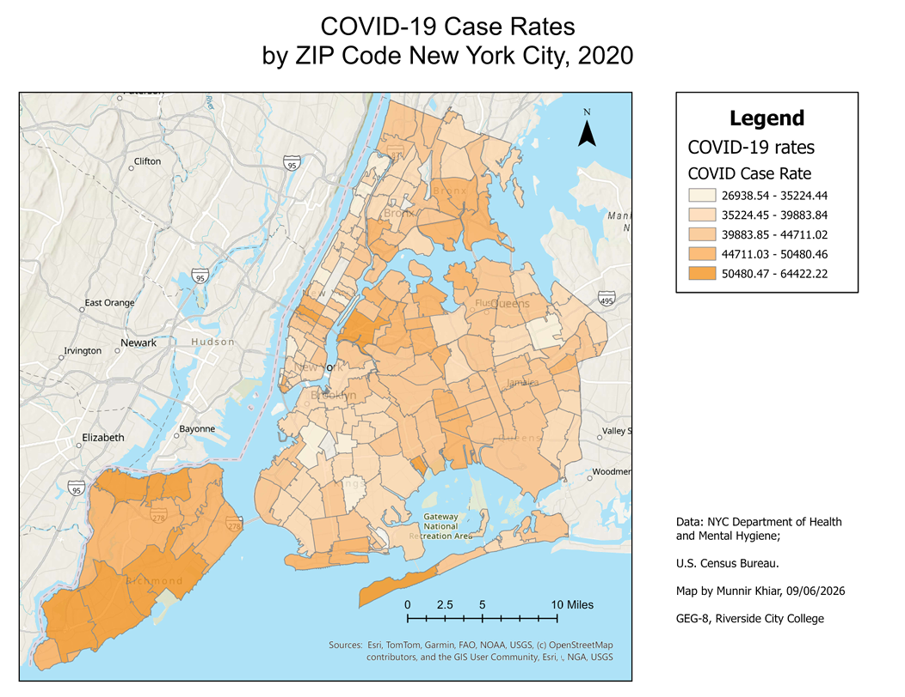

# mmkhiar.github.io

# Munnir Khiar
Hello! I am studying Data Science at Riverside City College. I want to learn how to apply data to maps and read the story the data is trying to tell!
---

## 2018 Kilauea Volcanic Eruption
This project was to examine the difference in the land environment before, during and after the 2018 Kilauea Volcanic Eruption

*Interactive version, live as of October 2026: https://storymaps.arcgis.com/stories/bedb235a1d6a4e9c8b3bf4dcd29f541e*

**Question:** What was the full extent of the impact of the Kilauea volcanic eruption in 2018?

**Data:** The data comes from Landsat-8 image courtesy of the U.S. Geological Survey; Kilauea 2018 Lava Flow Extents courtesy of ESRI: Learn ArcGIS

**Method:** The method of analysis for this project was to overlay remotely sensed multispectral imagery and compare the before, during, and after of the island.

**A design choice I made and why:** One design choice I made when presenting the findings was to have a dark background with light text. I feel this better conveys the seriousness of our topic.

**A limitation of this map:** I wish we could see the housing in the affected area more clearly. It would have added another dimension to the scale of the eruption and its impact.

## [New York City Covid Rates]

**Question:** Does population density foreshadow how the covid rates of transmission affect a city?

*Interactive version, live as of September 2026: https://rccgis24.maps.arcgis.com/apps/instant/basic/index.html?appid=8aa3e96e2088430c98e02740d087155b*

**Data:** The data comes from:

US Census States Feature Layer provided by Esri; 
U.S. Department of Commerce, Census Bureau; U.S. Department of Commerce (DOC), 
National Oceanic and Atmospheric Administration (NOAA), National Ocean Service (NOS), 
National Geodetic Survey (NGS)

COVID Cases Distribution and COVID-19 Cases USA layers from the Center for
Systems Science and Engineering (CSSE) at Johns Hopkins University.
USA Freeway System of the National Highway Planning Network, published by the Federal
Highway Administration as part of the National Transportation Atlas Databases for the United
States.

**Method:** The goal of this project was to see how COVID spread among different population densities in New York City. We first cleaned the data and presented the different population densities, then overlaid the COVID data for New York City.

**A design choice I made and why:** For the COVID rates, I wanted the design to be easy to read and understand. I chose orange and used saturation to differentiate the zip codes. 

For the swipe map, it was a little different, as three layers overlapped (you can disable a layer to focus on the other two). The three layers were COVID counts in orange bubbles, population density (ranging from light yellow to dark purple), and COVID infection rates, shown in blue with saturation indicating density. Population density ranged from light yellow to dark purple to highlight the large difference in New York City. 

The swipe map shows that lower-density areas were hit harder than high-density areas. 

**A limitation of this map:** The city of New York is pretty long, and it was hard to get it into one screen without a lot of extra space on the side. Also, the count bubbles consistently ended up bigger than the ZIP code they represent. One way to overcome that limitation was to make the bubbles smaller, but it would compress the data, as a lot of the bubbles then looked very similar.

